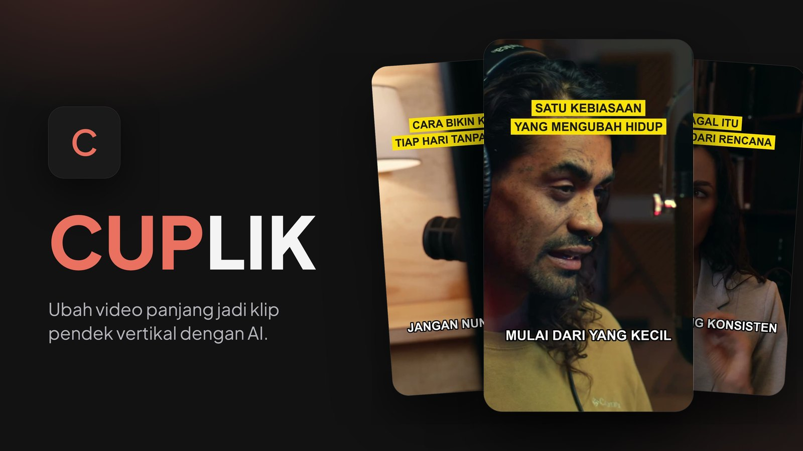
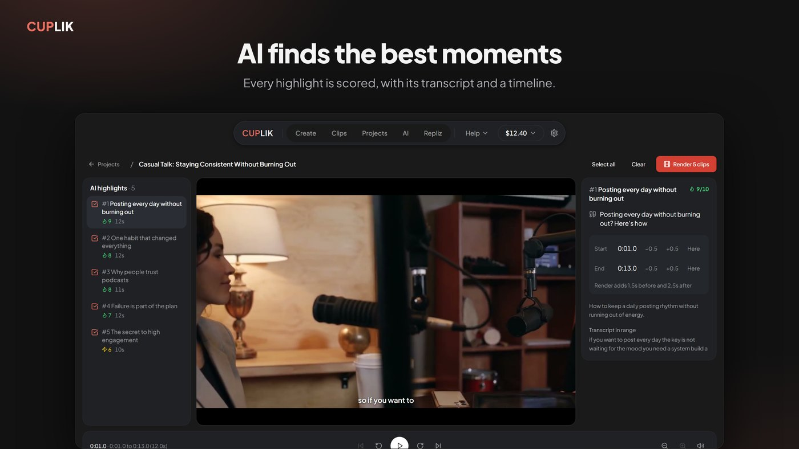
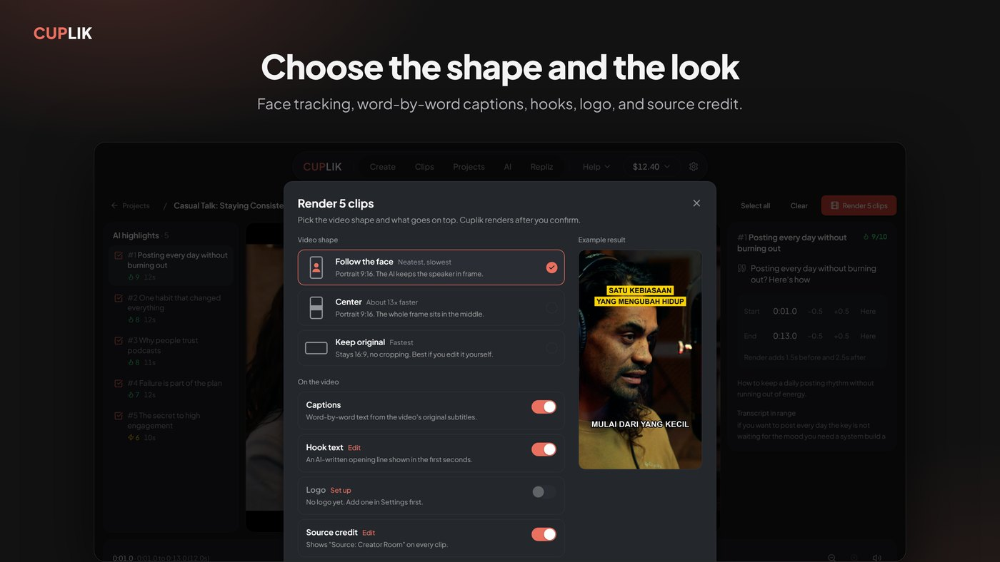
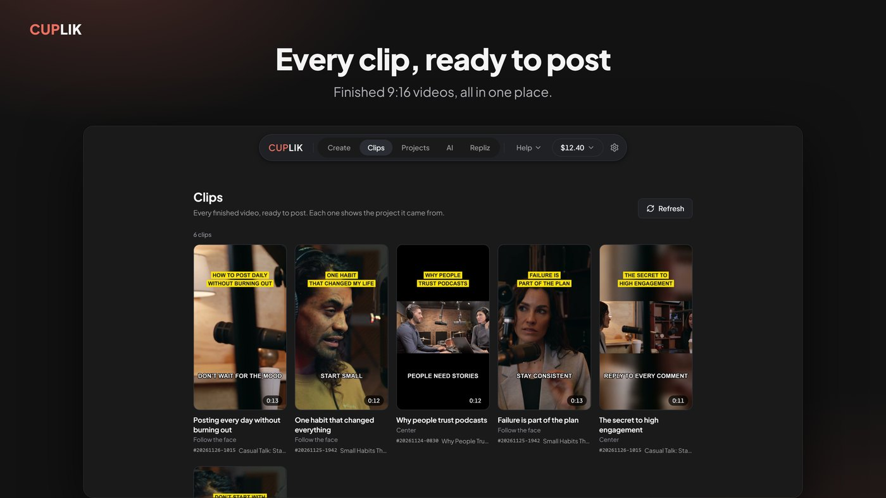
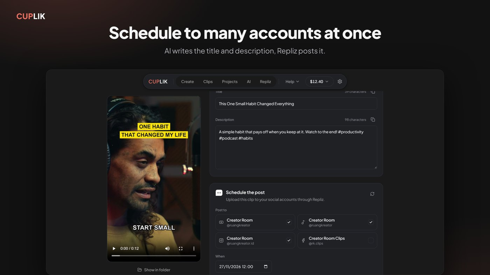
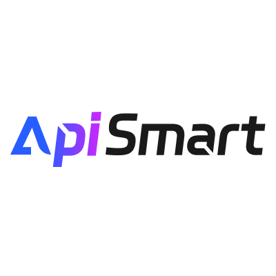

<p align="center">
  
</p>

<h1 align="center">Cuplik</h1>

<p align="center">
  Turn long videos into short vertical clips with AI.<br>
  Find the highlights, trim them on a timeline, render with captions and hooks, then schedule your posts.
</p>

<p align="center">
  <a href="https://apps.microsoft.com/detail/9PHPBBFP7PPH">
    
  </a>
  <br>
  <sub><b>Microsoft Store: coming soon.</b> The listing is in certification; the link goes live once it is approved.</sub>
</p>

> [!IMPORTANT]
> **YT Short Clipper v2 is now Cuplik.** Same app, same features, new name and a fully
> redesigned interface in Indonesian and English. Only the display name changed: the
> repository, the app identifier (`com.jipraks.ytshortclipper-v2`), your saved settings,
> projects, clips and AI balance all carry over. Release file names still use the old
> name until the next release.

<p align="center">
  
</p>

## Screenshots

| | |
| --- | --- |
|  |  |
| **Editor.** The AI scores every highlight; trim each one on the timeline with the transcript beside it. | **Render.** Pick the video shape and what goes on top, with a live example of the result. |
|  |  |
| **Clips.** Every finished video in one place, each linked to the project it came from. | **Post.** AI writes the title and description; Repliz schedules it to many accounts at once. |

<sub>Screenshots use stock footage (Mixkit) and invented demo data.</sub>

## About

Cuplik (formerly **YT Short Clipper v2**) is a Windows desktop app that turns a long-form
YouTube video into ready-to-post 9:16 short-form clips: it picks the highlights with an
LLM, reframes to portrait, and burns in word-by-word captions.

**Stack:** React 19 + TypeScript + Vite · Tauri v2 (Rust shell) · Python sidecar (yt-dlp,
FFmpeg, MediaPipe)

> **Windows only.** The build scripts are PowerShell, the app ships as a portable zip with
> a WebView2 bootstrapper (and soon through the Microsoft Store as an MSIX), and
> caption/hook rendering reads fonts from `C:\Windows\Fonts`. Nothing is macOS/Linux-ready
> today.

> **Status: beta.** Expect rough edges and breaking changes between releases.

## What it does

1. You paste a YouTube URL and upload your own `cookies.txt` (see
   [YouTube cookies](#youtube-cookies)).
2. yt-dlp fetches the video and its original subtitle track.
3. An LLM reads the transcript and proposes highlight segments (58–120s by default).
4. Each segment is cut, reframed to 9:16, captioned, and written out as an MP4.
5. Optionally, clips are uploaded and scheduled through [Repliz](https://api.repliz.com).

## Features

- **AI highlight detection** from the video's subtitle transcript, via any
  OpenAI-compatible endpoint
- **AI direction** per video — free-text steering: name a time range, chase a recurring
  topic, or rule material out
- **Output language** for titles and hook text, defaulting to the video's own language
- **Portrait reframe** in three modes: face tracking (MediaPipe), centered on black bars,
  or centered on a blurred fill — the centered modes are dramatically faster since they
  skip per-frame face detection
- **Word-by-word captions** burned from YouTube's original subtitle track — no
  transcription API and no local Whisper model required
- Optional **hook text overlays** and logo/credit watermarks
- **Clips and Projects** pages: every finished video in one place, linked back to the
  project (one per source video) it came from
- **Direct upload** to the Repliz social media platform, with a scheduled-post summary
- **Indonesian and English** interface, switchable in Settings

### AI providers

One provider serves the whole app — highlight detection and title generation both — and
is chosen once on the **AI** page. There are two ways to power it.

**In-app AI.** The app provisions its own wallet for this installation on first launch: no
registration, no email, no API key to paste. Top up with QRIS from inside the app and the
balance shows in the top navigation bar. The wallet is held by a key kept in the OS credential store
(Windows Credential Manager, Keychain, libsecret) — never in a config file. There is no
server-side recovery, so export that key and keep it somewhere safe: it is the only way
to reach the balance from another machine, and nobody can restore it for you. Top-ups are
not refundable.

**Your own API key.** Anything OpenAI-compatible works; the app ships presets for OpenAI,
Google Gemini, Groq, ApiSmart, the web wallet at ai.ytclip.org, and a Custom/Local option
for vLLM, Ollama, or similar. Your key is stored in the app's local data directory and is
never sent anywhere except the provider you configured.

The two are separate wallets. A balance topped up at ai.ytclip.org is reached through the
"YTClip AI (Web)" preset under your own API key, not through the in-app balance.

### AI direction

Left empty, the model picks clips on its own. Filled in, the direction outranks the
built-in selection principles:

- An explicit clock range (`2:00 - 2:50`) is used **exactly** — that clip is exempt from
  the usual 58–120s duration filter, and the run samples at a lower temperature so the
  instruction is actually followed.
- Array order is clip order, so "clip pertama dari …" lands first in the list.
- Anything the direction rules out is left out.

Custom highlight instructions (on the **AI** page) can place the direction with a
`{user_direction}` placeholder; without it the direction is appended at the end.

## YouTube cookies

The app needs cookies from a logged-in YouTube session for yt-dlp to fetch subtitles and
video. You supply your own — nothing is bundled.

1. Open YouTube in your browser and make sure you are logged in.
2. Install the **Get cookies.txt LOCALLY** extension.
3. Run it while on `youtube.com` and export `cookies.txt`.
4. In the app, choose that file in the setup's cookies step, or later from the cookie
   status on the **Create** page.

Notes:

- Don't log out of YouTube after exporting — that invalidates the cookies.
- Frequent 403s mean the cookies went stale; export a fresh file.
- A valid export contains `SID`, `HSID`, `SSID`, `APISID`, `SAPISID`, and `LOGIN_INFO`.
- `cookies.txt` grants access to your Google account. It is gitignored here, stored only
  in the app's local data directory, and passed to yt-dlp on your machine — but treat the
  file itself like a password and never share it.

## Prerequisites

- [Node.js](https://nodejs.org/) v18+
- [Rust](https://www.rust-lang.org/) latest stable
- [Python](https://www.python.org/) 3.13+
- Windows 10/11 with PowerShell

## Setup

```bash
# 1. Install Node dependencies
npm install

# 2. Install Python dependencies
py -m pip install -r requirements.txt

# 3. Download runtime binaries (FFmpeg, Deno)
#    Existing files are skipped — add -Force to actually re-download them.
powershell -ExecutionPolicy Bypass -File scripts/fetch-deps.ps1

# 4. Build the Python sidecar executable
npm run build:sidecar
```

FFmpeg must be a **GnuTLS** build (the fetch script pulls one from gyan.dev). Schannel
builds hang forever on the byte-range requests used for section downloads.

## Development

```bash
npm run dev          # Start Vite dev server
npm run tauri dev    # Start Tauri dev window
```

> **Python changes need a sidecar rebuild.** `src-tauri/binaries/ytclip-sidecar-*.exe`
> takes precedence over the dev Python module, so edits under `yt_short_clipper_core/`
> do nothing until you run `npm run build:sidecar` — the app keeps running the frozen
> copy without complaining. Delete that binary to fall back to
> `py -m yt_short_clipper_core.sidecar` for fast iteration. Frontend and Rust changes
> hot-reload as usual.

### Updating yt-dlp

```bash
py -m pip install --upgrade yt-dlp   # 1. upgrade the package
                                     # 2. bump the floor in requirements.txt
npm run build:sidecar                # 3. re-freeze it into the sidecar
```

Check the yt-dlp changelog for a raised **Deno** floor while you are there (2026.06.09
raised it to v2.3.0). Deno drives `remote_components` for YouTube's JS challenges, so an
under-floor binary breaks extraction quietly — and `fetch-deps.ps1` will not replace an
existing `deno.exe` without `-Force`.

## Microsoft Store build

```bash
npm run build:msix                 # Store package (unsigned; the Store signs it)
npm run build:msix -- -TestCert    # also a self-signed copy to install locally
```

`scripts/build-msix.ps1` builds the frontend with `VITE_STORE_BUILD=1` (no self-update
prompt; the Store updates the app), builds the release exe, stages the same layout as the
portable zip and packs `build/msix/Cuplik_<version>_x64.msix`. The package identity comes
from `store/msix/identity.json`; the listing copy and image list live in
`store/LISTING.md`. Rebuild the sidecar first whenever the Python code changed.

## Release Build

```bash
# One command: sidecar → frontend → Tauri build → assemble portable zips
npm run release
```

This produces two zips in `src-tauri/target/release/bundle/`:

- `YTShortClipperV2_<version>_x64_portable.zip` — full bundle for new users
- `YTShortClipperV2_<version>_x64_update.zip` — app + sidecar only, for existing users

See [BUILD_GUIDE.md](BUILD_GUIDE.md) for the full release flow, version bumping
(4 files), and the build-only-what-changed shortcuts.

## Network calls & telemetry

Being transparent about every host the app talks to, since some of it is the maintainer's
own backend rather than a third party:

| Endpoint | When | What is sent |
|---|---|---|
| YouTube / `googlevideo` (via yt-dlp) | Fetching video + subtitles | Your YouTube cookies |
| Your configured AI provider | Highlight + title generation | Subtitle transcript, your prompt, your API key |
| `api-v2.ytclip.org/api/public/v1` | Only if you use in-app AI | Platform and app version at activation; afterwards your device token, to read the balance and create QRIS invoices |
| `ai-api.ytclip.org/v1` | Only if you use in-app AI | Subtitle transcript and your prompt, with the key the app issued itself |
| `api-v2.ytclip.org/api/public/v1/app` | On launch | Nothing — the request carries no parameters |
| `api-v2.ytclip.org/api/public/v1/notification` | On launch | Nothing |
| `api-v2.ytclip.org/api/public/v1/menu` | On launch | Nothing |
| `google-analytics.com/mp/collect` | After a clip renders | Random installation ID, app version, clip duration, reframe mode |
| `api.ytclip.org/webhook/yt-clipper/presigned-url` + `api.repliz.com` | Only if you use Repliz upload | Filename, the video file, your Repliz keys |

No video content or transcript is sent to any `ytclip.org` host except the AI endpoint you
pick — and that one only receives what you would send any AI provider. The installation ID
is a random UUID generated locally on first run, not tied to any account.

Google Analytics is the one third party here. It receives the installation ID, the app
version, and each finished clip's duration and reframe mode — plus, as with any HTTP
request, your IP address, which Google uses for coarse geolocation. No video, transcript,
title, or URL is sent. Builds without `GA_API_SECRET` set at compile time send nothing at
all.

If you fork this, point these at your own backend or strip them out — see
[`src/hooks/`](src/hooks/) and [`src-tauri/src/commands/analytics.rs`](src-tauri/src/commands/analytics.rs).

### Help menu links

The external links in the **Help** menu of the top navigation bar are served by
`api-v2.ytclip.org/api/public/v1/menu`, so they can change without an app release. The
page routes in the bar (Create, Clips, Projects, AI, Repliz) stay hardcoded.

Responses are validated (https-only URLs, capped count and label length, bad entries
dropped individually), cached, and fall back to `DEFAULT_MENU_ITEMS` in
[`src/hooks/menu.ts`](src/hooks/menu.ts) when offline.

## Sponsors

### AI Provider Sponsor

<a href="https://www.apismart.ai">
  
</a>

### Become a sponsor

Interested in sponsoring this project? Reach out at
[sponsorship@ytclip.org](mailto:sponsorship@ytclip.org).

## Legal

This tool automates downloading and re-cutting YouTube videos. Only use it on content you
own or are otherwise licensed to reuse; downloading or republishing third-party videos may
violate YouTube's Terms of Service and copyright law in your jurisdiction. You are
responsible for what you process and post. The maintainer provides no warranty and accepts
no liability — see [LICENSE](LICENSE).

Not affiliated with, endorsed by, or sponsored by YouTube, Google, OpenAI, or Repliz.

## License

[MIT](LICENSE) © Aji Prakoso
